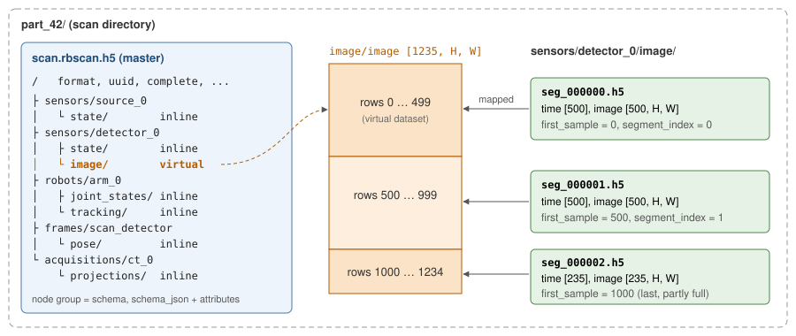
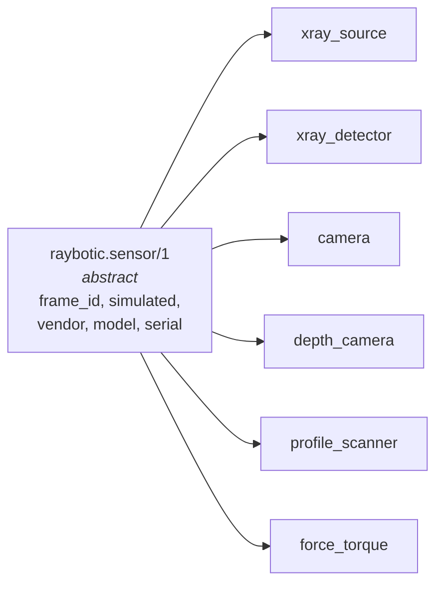

# rbscan format 1.0

This document describes how a scan is laid out on disk: the files, the HDF5
groups and datasets, and how a schema turns into those groups and datasets.
What each built-in schema stores is in [schemas.md](schemas.md).

## Overview

A scan is a **directory**. It holds one HDF5 master file and, for every
segmented series, a folder of segment files. All files use the HDF5 1.10 file
format (needed for SWMR and virtual datasets) and can be read with HDF5 ≥ 1.10.



Four terms are used throughout:

| Term | What it is | On disk |
|---|---|---|
| **Schema** | A JSON definition of a kind of node: which attributes it has and which series it records, with types, shapes and units. Example: `raybotic.xray_detector/1`. | Embedded as `schema_json` in every node that uses it |
| **Node** | One thing in the scan, e.g. a detector, a robot, a TF edge, a CT acquisition. Every node follows exactly one schema. | Group `/<category>/<name>` in the master |
| **Attribute** | A value that is constant for the node, e.g. pixel pitch, joint names, frame id. | HDF5 attribute on the node group |
| **Series** | A table that grows over time: one row (*sample*) per time stamp, one column (*field*) per measured quantity, plus `time`. | Group `<node>/<series>` with one dataset per field |

A series is stored either **inline** (all rows in the master, for low-rate data
such as kV, joint states or poses) or **segmented** (rows split over segment
files, for images and other large samples). Readers see no difference: in the
master both are a group with one dataset per field.

## Conventions

- **Time**: every series has a dataset `time`, int64, ns since the Unix epoch
  (ROS time). It never decreases within a series. Simulations use the same clock.
  Series of different nodes share this clock, so they can be aligned by time
  (see [Aligning series](#aligning-series)).
- **Units**: SI, unless the field name or the schema says otherwise (`_kv`,
  `_ua`, `_mm`, `_ms`, as in the ROS messages). Every dataset carries `units`
  and `description` attributes when the schema gives them.
- **Poses**: frames as in ROS TF. A quaternion is `x, y, z, w`. A pose in one
  array is `px, py, pz, qx, qy, qz, qw`.
- **Arrays**: row-major, the first dimension is the sample index. An image
  series of N images with H rows and W columns is `[N, H, W]`.
- **Strings**: variable-length UTF-8. Booleans use the h5py enum
  (`FALSE = 0, TRUE = 1` on int8), so numpy reads them as `bool`.
- **Names**: categories, node names, series, fields and attributes use
  `[A-Za-z0-9_]` only.
- **Node references**: a node that refers to another node stores its path
  relative to the root as a string attribute, e.g. `detector =
  "sensors/detector_0"`. A sensor refers to its TF frame by name (`frame_id`);
  the frame's pose is the node `frames/<frame_id>`.

## Master file `scan.rbscan.h5`

### Root attributes

| Attribute | Type | |
|---|---|---|
| `format` | string | `raybotic.scan` |
| `format_version` | string | `1.0` |
| `uuid` | string | random UUID v4 of this scan |
| `created`, `finalized` | string | ISO 8601 UTC |
| `software` | string | `rbscan <version>` |
| `complete` | bool | true once finalized or rebuilt; false while recording or after a crash |
| `description`, `operator`, `sample_id` | string | optional |
| anything else | | `ScanInfo::extra` |

### Categories and nodes

Below the root there is one group per **category** and, inside it, one group
per **node**. The category comes from the schema, the name from the writer:

```
/sensors/<name>          xray_source, xray_detector, camera, depth_camera,
                         profile_scanner, force_torque
/robots/<name>           robot_arm
/frames/<child frame>    transform
/acquisitions/<name>     ct_acquisition
/trajectories/<name>     trajectory_plan
/reconstructions/<name>  reconstruction
/volumes/<name>          volume
/annotations/<name>      annotations
/imports/<name>          ezrt_import
/simulations/<name>      simulation_scene
/<category>/<name>       whatever a custom schema declares
```

A node group carries:

- `schema`: the id, e.g. `raybotic.xray_detector/1`
- `schema_json`: the flat schema (with `extends` resolved), so the file
  describes itself and can be read without knowing the schema
- its attributes, with the types the schema declares (an `array` attribute is
  a 1-D HDF5 attribute); undeclared attributes may be added

### Series

Each series is a subgroup `<node>/<series>` with attribute `storage`
(`inline` or `segmented`) and one dataset per field plus `time`. All datasets
of a series have the same first dimension N, the number of samples; row *i* of
every dataset belongs to `time[i]`. The remaining dimensions are the field's
shape:

```
/sensors/detector_0/state/time                  int64   [N]
/sensors/detector_0/state/integration_time_ms   float64 [N]
/sensors/detector_0/image/time                  int64   [M]        (virtual)
/sensors/detector_0/image/image                 uint16  [M, H, W]  (virtual)
/robots/arm_0/joint_states/position             float64 [K, 6]     (6 = len(joint_names))
```

Inline datasets are chunked (about 256 KB per chunk) and compressed with
shuffle + deflate. They grow while recording; their maximum size is unlimited.

### Aligning series

Each series has its own time axis; nothing is resampled. To know the state of
another series at time *t*, a reader takes:

- for **state** series (detector `state`, source `state`, robot `tracking`,
  written "one sample per change"): the last sample at or before *t*;
- for **poses** (`frames/*/pose`): linear interpolation of the translation and
  slerp of the rotation between the samples around *t*. A static transform
  has a single sample that holds at all times.

`rbscan resolve-geometry` uses exactly these rules to build the projection
table of an acquisition (see [schemas.md](schemas.md#rayboticct_acquisition1)).

## Segment files

```
<scan>/<category>/<node>/<series>/seg_000000.h5
```

- Each segment holds `segment_size` samples (default 500); the last one may hold
  fewer.
- Datasets: `time` and one per field, `[n, sample shape]`, chunked
  (one image per chunk, smaller samples up to about 1 MB per chunk).
- Compression (`Compression`, `compression=` in Python):
  - `ShuffleDeflate` / `"shuffle_deflate"`: HDF5 byte shuffle +
    deflate. Built into every HDF5 installation; best compression ratio for
    16-bit images.
  - `BitshuffleLZ4` / `"bitshuffle_lz4"` (default): HDF5 filter 32008 (`bitshuffle` with
    LZ4, as used by Dectris detectors). Decodes several times faster than
    deflate at a slightly larger file size. rbscan reads and writes it natively
    (and registers filter 32008 with HDF5 for virtual datasets); external tools
    need the bitshuffle filter plugin (`import hdf5plugin` in Python before
    opening with `h5py`).
  - `Deflate` / `"deflate"`: zlib deflate without byte shuffle.
  - `None` / `"none"`: uncompressed chunks, read directly into the destination
    buffer without a copy.
- Root attributes:

  | Attribute | |
  |---|---|
  | `format` | `raybotic.scan.segment` |
  | `format_version` | `1.0` |
  | `node_path` | e.g. `sensors/detector_0` |
  | `schema`, `schema_json` | as on the node group |
  | `series` | e.g. `image` |
  | `segment_index` | k, as in the file name |
  | `first_sample` | index of the segment's first row in the whole series |
  | `segment_size` | samples per full segment |

- Group `node_attributes`: the node's attributes. A node recorded by another
  process can therefore be recreated in the master on finalize or rebuild.

The master's segmented series group holds one virtual dataset per field. It
maps segment *k* to rows `[first_k, first_k + n_k)`. The source file names are
relative to the master's directory, so the scan directory can be moved or
copied as a whole. The attribute `segment_count` is set as well.

### Writing

```
append() --copy--> chunk buffer --full--> thread pool (shuffle + deflate)
                                               |
                                               v (in order)
                                   writer thread: H5Dwrite_chunk, H5Dset_extent
```

- `append()` blocks only when `max_pending` chunks are waiting.
- Every `flush_every` samples (default 16), partial chunks are written and the
  file is flushed, so SWMR readers see the newest samples.
- The encoded chunks are byte-identical to what HDF5's shuffle, deflate and
  bitshuffle (32008) filters produce. On read, rbscan looks up chunk offsets
  and reads and decodes one-sample-per-chunk datasets outside the global HDF5
  lock (using its own thread pool for range reads and direct OS positional
  reads into the caller's buffer for uncompressed chunks).

### Several processes

A segmented series does not need the master file. A detector node in its own
process can call

```cpp
SegmentedSeriesWriter::open(scan_dir, "sensors/detector_0", "raybotic.xray_detector",
                            "image", dims, options, attributes);
```

The process that owns the master calls `finalize()` when everything is done.
If it finishes earlier, call `ScanWriter::rebuild(scan_dir)` afterwards. Both
scan the directory and link every segment they find.

If a writer crashes or is killed, the master keeps `complete = false` and the
HDF5 superblock still says it is open for writing, so readers refuse it.
`rebuild` clears that state (as `h5clear -s` would) and links the segments; every
sample flushed before the crash is kept. Run it only once no process writes the
scan any more (HDF5 file locking refuses it while the writer is alive).

While the master is open for writing, other processes cannot open it (HDF5
file locking). To follow a recording live, use
`SeriesReader::open_segments(scan_dir, node_path, series)` and `refresh()`.

### Editing a finished scan

`ScanWriter::open(dir)` opens an existing scan to add, replace or remove nodes
(resolved geometry, volumes, reconstruction runs, annotations).
`ScanWriter::node(path)` also opens a node of an earlier session, so a run's
`status` can be set when it ends. Such a node takes attributes, and its stored
inline series go on: `series(name)` resumes appending after the last sample
(times must not decrease), with the series' stored types, chunking and
compression. It takes no new series and no segmented ones.

## Schemas

A schema is a JSON object. The built-in ones are in [`schemas/`](../schemas)
and compiled into the library; custom ones are registered at run time
(`register_schema(json)` in C++ and Python) or found in a folder listed in
`RBSCAN_SCHEMA_PATH`. Example:

```json
{
  "schema": "raybotic.xray_detector",
  "version": 1,
  "extends": "raybotic.sensor/1",
  "category": "sensors",
  "abstract": false,
  "description": "...",
  "attributes": {
    "sensor_width": { "dtype": "uint32", "required": true, "units": "px", "description": "..." },
    "focal_spots_um": { "dtype": "float64", "array": true }
  },
  "series": {
    "image": {
      "storage": "segmented",
      "description": "...",
      "fields": {
        "image": { "dtype": "uint16", "shape": ["height", "width"], "units": "counts" },
        "dark": { "dtype": "float32", "shape": ["height", "width"], "optional": true }
      }
    }
  }
}
```

### Top level

| Key | | |
|---|---|---|
| `schema` | required | Name, e.g. `raybotic.xray_detector`. Custom schemas use their own prefix. |
| `version` | required | Integer. The id is `name/version`. |
| `category` | required unless inherited | Group the nodes go into (`sensors`, `robots`, ...). |
| `extends` | optional | Id of a base schema; see [Inheritance](#inheritance). |
| `abstract` | optional | `true`: only a base for other schemas, no node can use it. |
| `description` | optional | Free text, copied into `schema_json`. |
| `attributes` | optional | Name → attribute spec. |
| `series` | optional | Name → series spec. |

### Attribute spec

| Key | |
|---|---|
| `dtype` | `bool`, `int8` … `int64`, `uint8` … `uint64`, `float32`, `float64`, `string` |
| `array` | `true`: a 1-D list of that type instead of a scalar (e.g. `joint_names`, a 4x4 matrix as 16 values) |
| `required` | `true`: creating the node without it fails |
| `units`, `description` | free text |

### Series spec

| Key | |
|---|---|
| `storage` | `inline` (default) or `segmented` |
| `description` | free text; says what one row is and what its time means |
| `fields` | name → field spec; at least one. `time` is implicit and reserved. |

### Field spec

| Key | |
|---|---|
| `dtype` | as for attributes, but no `string`. A list (`["uint16", "float32"]`) allows several types: the first is the default and the writer picks one per series. Readers take the type from the data. |
| `shape` | Shape of one sample; missing = scalar. A list of fixed sizes and/or names (see below). |
| `optional` | `true`: may be left out on append; it is filled with NaN (floats) or 0 / false. |
| `units`, `description` | free text, written as dataset attributes |

A **name in a shape** is resolved when the series is created: first from the
explicit `dims` the writer passes, then from an integer node attribute of that
name, then from the length of an array attribute of that name. So
`"shape": ["joint_names"]` gives one column per joint, and
`"shape": ["height", "width"]` takes the image size from `dims` (detector) or
from the node's `height` and `width` attributes (camera).

### Inheritance

`extends` copies category, attributes and series of the base schema; entries
of the derived schema with the same name replace the inherited ones. All
concrete sensors extend the abstract `raybotic.sensor/1`, so every sensor
node has `frame_id` and `simulated`:



`schema_json` stores the result with `extends` resolved, so a reader never
needs the base schema.

### Versions

- Change the version when a field or attribute changes meaning, units or type.
- Adding optional fields or attributes does not need a new version.
- Readers ignore attributes they do not know, and writers may add undeclared
  attributes.
