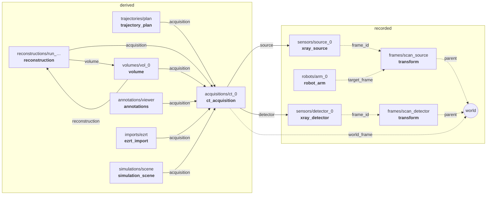
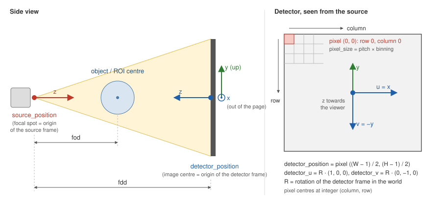
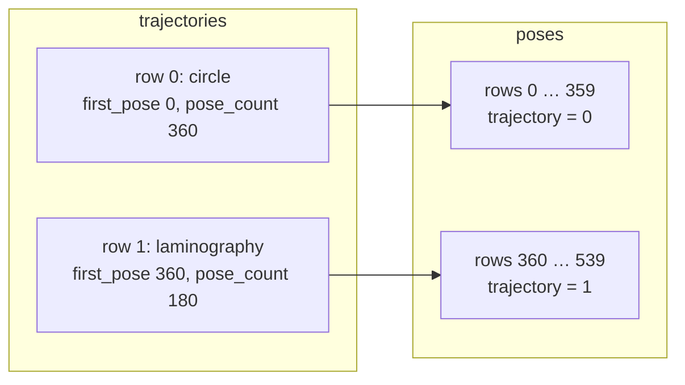

# Built-in schemas

This is what each built-in schema stores: its attributes (constant per node)
and its series (one row per time stamp). How these turn into HDF5 groups and
datasets, and how a schema is written, is in [format.md](format.md). The
definitions themselves are the JSON files in [`schemas/`](../schemas); every
node also carries its schema as `schema_json`. Each schema also has a typed
C++ and Python API generated from it: [api.md](api.md).

In the tables below, **Req.** marks required attributes, **Shape** is the shape
of *one* sample (the stored dataset has one more leading dimension, the sample
index), and every series also has `time` (int64, ns since the Unix epoch).
`float64[]` is an array attribute; `float64[16]` one whose length is fixed by
its meaning (here a 4x4 matrix).

## Overview

| Schema | Category | Series (storage) | One node is |
|---|---|---|---|
| [`raybotic.sensor/1`](#rayboticsensor1) | `sensors` | – | abstract base of all sensors |
| [`raybotic.xray_source/1`](#rayboticxray_source1) | `sensors` | `state` (inline) | an X-ray tube with its generator |
| [`raybotic.xray_detector/1`](#rayboticxray_detector1) | `sensors` | `image` (segmented), `state`, `calibration` (inline) | a flat-panel detector |
| [`raybotic.camera/1`](#rayboticcamera1) | `sensors` | `image` (segmented) | an optical camera |
| [`raybotic.depth_camera/1`](#rayboticdepth_camera1) | `sensors` | `depth` (segmented) | a depth camera |
| [`raybotic.profile_scanner/1`](#rayboticprofile_scanner1) | `sensors` | `profile` (segmented) | a laser line scanner |
| [`raybotic.force_torque/1`](#rayboticforce_torque1) | `sensors` | `wrench` (inline) | a 6-axis force/torque sensor |
| [`raybotic.robot_arm/1`](#rayboticrobot_arm1) | `robots` | `joint_states`, `tracking` (inline) | a serial robot arm |
| [`raybotic.transform/1`](#raybotictransform1) | `frames` | `pose` (inline) | one edge of the TF tree |
| [`raybotic.ct_acquisition/1`](#rayboticct_acquisition1) | `acquisitions` | `scan_poses`, `projections` (inline) | one CT scan with its geometry |
| [`raybotic.trajectory_plan/1`](#raybotictrajectory_plan1) | `trajectories` | `trajectories`, `poses` (inline) | a set of planned trajectories |
| [`raybotic.reconstruction/1`](#rayboticreconstruction1) | `reconstructions` | `rois` (inline) | reconstruction settings or one run |
| [`raybotic.volume/1`](#rayboticvolume1) | `volumes` | `slices` (segmented) | a 3-D volume |
| [`raybotic.simulation_scene/1`](#rayboticsimulation_scene1) | `simulations` | `objects`, `vertices`, `triangles`, `registration` (inline) | the objects and settings of an X-ray simulation |
| [`raybotic.annotations/1`](#rayboticannotations1) | `annotations` | `markers`, `observations` (inline) | the annotations of a viewer |
| [`raybotic.ezrt_import/1`](#rayboticezrt_import1) | `imports` | `headers` (inline) | projections imported from EZRT `.raw` files |

### How the nodes of a scan refer to each other

Nodes are linked by string attributes that hold a node path (solid arrows) or a
frame name (dashed). Arrows point from the node that holds the attribute to the
node it names; the label is the attribute.



Rows are linked by index as well: `projections.image_index` is a sample of the
detector's `image` series, and `observations.projection` and
`headers` rows are rows of the acquisition's `projections`.
A simulation scene's `objects` rows own ranges of its `vertices`, `triangles`
and `registration` rows.

A minimal CT scan therefore has a source, a detector, the frames of both and
the acquisition. Robots, cameras and the derived nodes are optional.

---

## Sensors

### `raybotic.sensor/1`

Abstract: no node uses it directly. Every sensor schema extends it, so every
node under `sensors/` has these attributes as well.

| Attribute | Type | Req. | Meaning |
|---|---|:-:|---|
| `frame_id` | string | yes | TF frame the sensor's data is given in. Its pose over time is the node `frames/<frame_id>`. |
| `simulated` | bool | yes | true when the data comes from a simulation (gVXR, Gazebo, ...) |
| `vendor`, `model`, `serial` | string | | identification |
| `description` | string | | free text |

### `raybotic.xray_source/1`

X-ray tube and generator (`raybotic_xray_interfaces/SourceState`). `frame_id`
is the focal spot frame: origin in the focal spot, z along the central beam
towards the detector.

| Attribute | Type | Units | Meaning |
|---|---|---|---|
| `voltage_min_kv`, `voltage_max_kv` | float64 | kV | voltage range |
| `current_max_ua` | float64 | µA | maximum current |
| `power_max_w` | float64 | W | maximum power |
| `focal_spots_um` | float64[] | µm | selectable focal spot sizes |
| `target_material` | string | | anode material, e.g. `W` |
| `filter_material` | string | | pre-filter in the beam; empty or missing = none. Its thickness is in `state`. |

Series **`state`** (inline): the generator state, one row per change or at a
fixed rate. A reader takes the last row at or before a time *t* as the state at *t*.

| Field | Type | Units | Meaning |
|---|---|---|---|
| `emission_state` | uint8 | | 0 off, 1 starting, 2 on, 3 stopping, 4 fault (`SourceState.EMISSION_*`) |
| `emission_permitted` | bool | | interlock closed, door shut, key switch on |
| `voltage_setpoint_kv` | float64 | kV | set value |
| `current_setpoint_ua` | float64 | µA | set value |
| `focal_spot_um` *(optional)* | float64 | µm | selected focal spot |
| `voltage_kv` | float64 | kV | actual value; 0 while emission is off |
| `current_ua` | float64 | µA | actual value; 0 while emission is off |
| `power_w` | float64 | W | actual value; 0 while emission is off |
| `filter_thickness_mm` *(optional)* | float64 | mm | pre-filter thickness |

### `raybotic.xray_detector/1`

Flat-panel X-ray detector (`raybotic_xray_interfaces/DetectorState`). The raw
images are stored; corrections go to `calibration`. The detector frame is
shown in [Projection geometry](#projection-geometry).

| Attribute | Type | Req. | Units | Meaning |
|---|---|:-:|---|---|
| `sensor_width`, `sensor_height` | uint32 | yes | px | sensor size without binning |
| `pixel_pitch_u_um` | float64 | yes | µm | unbinned pitch along columns (x) |
| `pixel_pitch_v_um` | float64 | yes | µm | unbinned pitch along rows (-y) |
| `bit_depth` | uint8 | | bit | ADC resolution |
| `scintillator` | string | | | e.g. `CsI 600um` |

Series **`image`** (segmented): the projections. Image size and data type are
fixed for one recording (binning applied); `height` and `width` come from the
`dims` passed when the series is created.

| Field | Type | Shape | Units | Meaning |
|---|---|---|---|---|
| `image` | uint16 / float32 / uint8 | `[height, width]` | counts | row 0 at the top (+y), column 0 at the left (-x). uint16 for raw counts; float32 for corrected, normalised or simulated projections. |

Series **`state`** (inline): acquisition settings, one row per change.

| Field | Type | Units | Meaning |
|---|---|---|---|
| `binning` | uint8 | | pixels binned per direction; the binned pixel size is pitch × binning |
| `image_width`, `image_height` | uint32 | px | image size with binning |
| `integration_time_ms` | float64 | ms | integration time per image |
| `averages` | uint32 | | images averaged into one |
| `gain` | float64 | | detector gain setting |

Series **`calibration`** (inline): correction images, each taken at its time
with the settings in force then. Every field is optional, so a row may hold only
a dark image, for example.

| Field | Type | Shape | Units | Meaning |
|---|---|---|---|---|
| `dark` | float32 | `[height, width]` | counts | offset image |
| `flat` | float32 | `[height, width]` | counts | gain (bright) image |
| `bad_pixels` | uint8 | `[height, width]` | | non-zero = defective pixel |

### `raybotic.camera/1`

Optical camera, mono or colour. `frame_id` follows the ROS optical convention:
x right, y down, z forward.

| Attribute | Type | Req. | Units | Meaning |
|---|---|:-:|---|---|
| `width`, `height` | uint32 | yes | px | image size |
| `channels` | uint32 | yes | | 1 = mono, 3 = colour |
| `encoding` | string | yes | | `mono8`, `rgb8` or `bgr8` (`sensor_msgs/image_encodings`) |
| `camera_matrix` | float64[9] | | | intrinsics K, 3x3 row-major (fx 0 cx; 0 fy cy; 0 0 1) |
| `distortion_model` | string | | | `plumb_bob`, `rational_polynomial`, `equidistant` |
| `distortion` | float64[] | | | coefficients of that model |

Series **`image`** (segmented):

| Field | Type | Shape | Meaning |
|---|---|---|---|
| `image` | uint8 | `[height, width, channels]` | shape taken from the attributes |

### `raybotic.depth_camera/1`

Depth camera (structured light, ToF, stereo). `frame_id`: x right, y down,
z forward.

| Attribute | Type | Req. | Units | Meaning |
|---|---|:-:|---|---|
| `width`, `height` | uint32 | yes | px | image size |
| `camera_matrix` | float64[9] | | | intrinsics K, 3x3 row-major |
| `min_range_m`, `max_range_m` | float64 | | m | measuring range |

Series **`depth`** (segmented):

| Field | Type | Shape | Units | Meaning |
|---|---|---|---|---|
| `depth` | float32 | `[height, width]` | m | distance along z; NaN = no measurement |
| `confidence` *(optional)* | uint8 | `[height, width]` | | per-pixel confidence |

### `raybotic.profile_scanner/1`

Laser line / profile scanner: one profile of points per sample, in `frame_id`.

| Attribute | Type | Req. | Units | Meaning |
|---|---|:-:|---|---|
| `points_per_profile` | uint32 | yes | | points in one profile |
| `wavelength_nm` | float64 | | nm | laser wavelength |

Series **`profile`** (segmented):

| Field | Type | Shape | Units | Meaning |
|---|---|---|---|---|
| `points` | float32 | `[points_per_profile, 3]` | m | x, y, z per point; NaN = no measurement |
| `intensity` *(optional)* | uint16 | `[points_per_profile]` | | reflected intensity per point |

### `raybotic.force_torque/1`

6-axis force/torque sensor, values in `frame_id` (`geometry_msgs/Wrench`).

| Attribute | Type | Units | Meaning |
|---|---|---|---|
| `force_range_n` | float64 | N | measuring range |
| `torque_range_nm` | float64 | N m | measuring range |

Series **`wrench`** (inline):

| Field | Type | Shape | Units |
|---|---|---|---|
| `force` | float64 | `[3]` | N |
| `torque` | float64 | `[3]` | N m |

---

## Robots and frames

### `raybotic.robot_arm/1`

Serial robot arm (robot_cell): its joint states and how it followed its target
frame (`raybotic_robot_cell_interfaces/TrackingState`). Poses of its frames
(base, TCP, target) are not part of this node; they are `transform` nodes
under `frames/`.

| Attribute | Type | Req. | Meaning |
|---|---|:-:|---|
| `joint_names` | string[] | yes | joint order of every `joint_states` row; its length is the number of columns |
| `base_frame` | string | yes | TF frame of the robot base |
| `tcp_frame` | string | yes | TF frame of the tool centre point |
| `target_frame` | string | | frame the TCP tracks, e.g. `scan_source` |
| `simulated` | bool | yes | true for a simulated robot |
| `vendor`, `model`, `serial` | string | | e.g. model `FANUC CRX-30iA` |
| `urdf` | string | | robot description as used at runtime |

Series **`joint_states`** (inline): `sensor_msgs/JointState`.

| Field | Type | Shape | Units |
|---|---|---|---|
| `position` | float64 | `[len(joint_names)]` | rad |
| `velocity` *(optional)* | float64 | `[len(joint_names)]` | rad/s |
| `effort` *(optional)* | float64 | `[len(joint_names)]` | N m |

Series **`tracking`** (inline): one row per change of the tracking state.

| Field | Type | Units | Meaning |
|---|---|---|---|
| `status` | uint8 | | 0 no target, 1 tracking, 2 moving, 3 unreachable (`TrackingState.STATUS_*`) |
| `position_error` | float64 | m | distance between TCP and target |
| `orientation_error` | float64 | rad | angle between TCP and target |

### `raybotic.transform/1`

One edge of the TF tree: the pose of `child` in `parent` over time. The node is
named after the child frame (`frames/<child>`), so a frame name leads directly
to its node. Following `parent` from node to node gives the chain up to the
root (the world frame). A static transform has a single sample.

| Attribute | Type | Req. | Meaning |
|---|---|:-:|---|
| `parent` | string | yes | parent frame |
| `child` | string | yes | child frame, equal to the node name |
| `static` | bool | yes | true: the single sample holds at all times |

Series **`pose`** (inline): between two samples, readers interpolate the
translation linearly and the rotation by slerp.

| Field | Type | Shape | Units | Meaning |
|---|---|---|---|---|
| `translation` | float64 | `[3]` | m | origin of `child` in `parent` |
| `rotation` | float64 | `[4]` | | unit quaternion x, y, z, w |

---

## CT

### `raybotic.ct_acquisition/1`

One CT scan: it names the source and the detector and holds the resolved
geometry of every projection, so a reconstruction needs no TF lookup. All
geometry is in the world frame, lengths in m.

| Attribute | Type | Req. | Meaning |
|---|---|:-:|---|
| `type` | string | yes | `ct_scan`, `laminography`, `radiography`, ... |
| `source` | string | yes | node path of the source, e.g. `sensors/source_0` |
| `detector` | string | yes | node path of the detector, e.g. `sensors/detector_0` |
| `world_frame` | string | yes | frame all positions are given in |
| `trajectory` | string | | name or parameters of the planned trajectory |
| `description` | string | | free text |

Series **`projections`** (inline): one row per projection; time = exposure time.
`rbscan resolve-geometry` builds it from the detector's images, the frames and
the source and detector states.

| Field | Type | Shape | Units | Meaning |
|---|---|---|---|---|
| `image_index` | uint64 | | | sample in the detector's `image` series |
| `scan_pose_index` *(optional)* | uint64 | | | row in `scan_poses` |
| `source_position` | float64 | `[3]` | m | focal spot |
| `detector_position` | float64 | `[3]` | m | image centre, see below |
| `detector_u` | float64 | `[3]` | | unit vector along increasing column |
| `detector_v` | float64 | `[3]` | | unit vector along increasing row |
| `pixel_size` | float64 | `[2]` | m | binned pixel size along u, v |
| `projection_matrix` *(optional)* | float64 | `[3, 4]` | | world point (m) to pixel (column, row) |
| `voltage_kv` | float64 | | kV | source voltage at the exposure |
| `current_ua` | float64 | | µA | source current at the exposure |
| `integration_time_ms` *(optional)* | float64 | | ms | detector integration time |
| `flags` | uint32 | | | quality bits, see below |

Series **`scan_poses`** (inline): the planned poses as
`raybotic_scan_pose_interfaces/ScanPose`: `roi` in the world, `source` and
`detector` in the roi frame, each as `px, py, pz, qx, qy, qz, qw`.

| Field | Type | Shape |
|---|---|---|
| `roi` | float64 | `[7]` |
| `source` | float64 | `[7]` |
| `detector` | float64 | `[7]` |

#### Projection geometry



The conventions match `raybotic_scan_pose_interfaces/ScanPose`:

- **Source frame** (`frame_id` of the source): its origin is the focal spot,
  z is the central beam. `source_position` is that origin in the world.
- **Detector frame** (`frame_id` of the detector): its origin is the centre of
  the active area, x points to image right (increasing column, as seen from
  the source), y points up, z is the normal towards the source. Rows therefore
  run along -y, so `detector_u = R·(1, 0, 0)` and `detector_v = R·(0, -1, 0)`,
  with R the detector's rotation in the world.
- `detector_position` is the image centre, i.e. pixel coordinate
  ((W - 1) / 2, (H - 1) / 2), with pixel centres at integer coordinates. The
  world position of pixel (c, r) is
  `detector_position + (c - (W-1)/2)·pixel_size[0]·detector_u + (r - (H-1)/2)·pixel_size[1]·detector_v`.
- `pixel_size` = pitch × binning, where binning is the detector `state` in
  force at the image's time.
- `projection_matrix` P maps a homogeneous world point (x, y, z, 1) in m to
  (column, row, 1) · w.

How a row is resolved for an image at time *t*:

1. Source and detector poses: the TF chain from `world_frame` to each
   `frame_id` at *t*, each edge interpolated (translation linearly, rotation by
   slerp).
2. Binning, integration time: the last detector `state` row at or before *t*.
3. Voltage, current, emission: the last source `state` row at or before *t*.
4. Robots: the last `tracking` row at or before *t* of every robot.

`flags`:

| Bit | Name | Set when |
|---|---|---|
| 0 | invalid | *t* lies outside the recorded samples of a frame on the chain (the nearest sample was used) |
| 1 | interpolated | the geometry was interpolated between frame samples |
| 2 | robot unreachable | a robot's tracking status was 3 (unreachable) |
| 3 | emission unstable | the source's `emission_state` was not 2 (on) |

### `raybotic.trajectory_plan/1`

Planned scan trajectories, driven one after another in the order of the
`trajectories` table. Each trajectory is an orbit (circle or laminography)
about a centre; its poses are the planned scan poses. Every pose is stored in
full, also those on the orbit, so a reader needs no orbit generator. Both
tables are plain series, no document to parse. Every row's time is when the
plan was written. A plan made before a scan can live in a scan of its own.

| Attribute | Type | Req. | Meaning |
|---|---|:-:|---|
| `application` | string | yes | what wrote the plan, e.g. `RayBotic Viewer 0.1.1` |
| `modified` | string | | ISO 8601 UTC |
| `acquisition` | string | | node path of a ct_acquisition recorded from this plan |

The two series form a parent/child table: trajectory *i* owns the rows
`first_pose … first_pose + pose_count - 1` of `poses`, and each of those rows
has `trajectory = i`.



Series **`trajectories`** (inline): one row per trajectory, in drive order.

| Field | Type | Shape | Units | Meaning |
|---|---|---|---|---|
| `kind` | uint8 | | | 0 circle, 1 laminography |
| `centre` | float64 | `[3]` | m | point the orbit turns about |
| `axis` | float64 | `[3]` | | rotation axis (laminography: plate normal), unit vector |
| `start_direction` | float64 | `[3]` | | from the centre towards the source at angle 0 (projected normal to `axis`) |
| `tilt` | float64 | | deg | central beam against the plane normal to `axis`; 0 for a circle |
| `fod` | float64 | | m | focus (source) to centre |
| `fdd` | float64 | | m | focus to detector |
| `projections` | uint32 | | | poses the orbit was generated with |
| `start_angle` | float64 | | deg | angle of the first pose |
| `range` | float64 | | deg | angle covered; 360 closes the orbit |
| `counter_clockwise` | bool | | | direction about `axis` |
| `first_pose` | uint64 | | | row of its first pose in `poses` |
| `pose_count` | uint64 | | | rows in `poses` that belong to it |

Series **`poses`** (inline): one row per planned pose, trajectory after
trajectory. The ROI frame has z towards the source and y up; all poses are in
the world frame.

| Field | Type | Shape | Units | Meaning |
|---|---|---|---|---|
| `trajectory` | uint32 | | | row in `trajectories` |
| `angle` | float64 | | deg | orbit angle of the pose |
| `skip` | bool | | | switched off: not driven |
| `manual` | bool | | | moved by hand: not on the orbit at its angle |
| `roi_position` | float64 | `[3]` | m | |
| `roi_rotation` | float64 | `[4]` | | unit quaternion x, y, z, w |
| `source_position` | float64 | `[3]` | m | |
| `source_rotation` | float64 | `[4]` | | unit quaternion x, y, z, w |
| `detector_position` | float64 | `[3]` | m | |
| `detector_rotation` | float64 | `[4]` | | unit quaternion x, y, z, w |

### `raybotic.reconstruction/1`

Reconstruction settings. Attribute `config` is the complete settings document
(the RayBotic engine's `reco.json`) and the source of truth; the other
attributes and the `rois` table repeat parts of it for tools that do not parse
it.

- `reconstructions/current` is the configuration being edited.
- Every run leaves `reconstructions/run_<UTC time>` with the settings it used,
  plus `status`, `volume`, `software` and `message`. The volume points back
  with `reconstruction`.
- The acquisition's stored geometry is final: `detector_shift` moves the
  detector on top of it, `negate_detector_orientation = true` keeps it as
  stored (false flips u and v). A scan converted from EZRT therefore gets its
  folder's `reco.json` with the convention taken out (it is baked into the
  geometry) and without the folder list.
- Files the settings name (bad pixel mask, jitter shifts) stay outside the scan.

| Attribute | Type | Req. | Meaning |
|---|---|:-:|---|
| `config` | string | yes | the complete settings document (JSON) |
| `config_format` | string | yes | format of `config`, e.g. `raybotic.reco/1.0` |
| `acquisition` | string | | node path of the ct_acquisition whose projections are reconstructed |
| `algorithm` | string | | `fbp`, `srm`, `art`, `helix`, ... (from `config`) |
| `roi_names` | string[] | | name of each row of `rois` |
| `active_roi` | uint32 | | row of `rois` that `config` reconstructs |
| `modified` | string | | ISO 8601 UTC, when `config` was last written |
| `application` | string | | what wrote `config`, e.g. `RayBotic Viewer 0.1.1` |
| `status` | string | | runs only: `running`, `ok`, `cancelled` or `failed` |
| `volume` | string | | runs only: node path of the volume it produced |
| `software` | string | | runs only: engine name and version |
| `message` | string | | runs only: error or warning text |

Series **`rois`** (inline): one row per reconstruction region; time = when
`config` was written.

| Field | Type | Shape | Units | Meaning |
|---|---|---|---|---|
| `enabled` | bool | | | region is reconstructed |
| `dims` | uint32 | `[3]` | voxel | voxels along x, y, z |
| `voxel_size` | float64 | `[3]` | m | |
| `midpoint` | float64 | `[3]` | m | centre of the grid in the world frame |

### `raybotic.volume/1`

A 3-D volume (reconstruction, simulation, segmentation) stored as a stack of
slices along its k axis: sample k of `slices` is slice k. The series' time is
when the volume was made.

| Attribute | Type | Req. | Units | Meaning |
|---|---|:-:|---|---|
| `width` | uint32 | yes | voxel | voxels along i (columns) |
| `height` | uint32 | yes | voxel | voxels along j (rows) |
| `depth` | uint32 | yes | voxel | voxels along k (slices) |
| `voxel_to_world` | float64[16] | yes | m | 4x4 row-major affine from voxel index (i, j, k, 1) to world (x, y, z, 1) |
| `voxel_size` | float64[3] | yes | m | edge along i, j, k (the column norms of `voxel_to_world`) |
| `world_frame` | string | | | frame of the world coordinates |
| `quantity` | string | | | what the values are: `attenuation`, `gray_value`, `label`, ... |
| `value_units` | string | | | units of the values, e.g. `1/m` |
| `acquisition` | string | | | node path of the acquisition it was made from |
| `software` | string | | | what made it |
| `parameters` | string | | | settings it was made with, e.g. the `reco.json` |
| `reconstruction` | string | | | node path of the `reconstructions/<run>` that made it |

Voxel indices refer to voxel centres:

```
(x, y, z, 1)ᵀ = voxel_to_world · (i, j, k, 1)ᵀ      i = column, j = row, k = slice
```

Series **`slices`** (segmented):

| Field | Type | Shape | Meaning |
|---|---|---|---|
| `slice` | float32 / uint16 / uint8 | `[height, width]` | slice k, row j, column i |

So the dataset `volumes/<name>/slices/slice` is the whole volume as
`[depth, height, width]`, indexed `[k, j, i]`.

---

## Simulation

### `raybotic.simulation_scene/1`

The objects of an X-ray simulation - each a triangle mesh with its placement
and material - and the settings of simulation, tube and detector. Attribute
`document` is the application's complete scene document (for the RayBotic
Viewer the scene JSON, format `raybotic-simulation-scene/1`) and the source of
truth for placement and settings; its objects are the rows of `objects`, in
order, and name no mesh files. The `objects` and `registration` tables and the
setting attributes repeat it for tools that do not parse it.

The meshes are stored only here, in `vertices` and `triangles`, exactly as the
application holds them (bit for bit, float32): in the file units of their
source, so the placement still applies. An STL has no unit; `objects.unit`
says what the application took it for. Nothing is welded, closed or reordered,
so an open or damaged mesh stays as it was.

| Attribute | Type | Req. | Units | Meaning |
|---|---|:-:|---|---|
| `application` | string | yes | | what wrote the scene, e.g. `RayBotic Viewer 0.1.1` |
| `format` | string | yes | | format of `document`, e.g. `raybotic-simulation-scene/1` |
| `document` | string | yes | | the complete scene document (JSON) |
| `modified` | string | | | ISO 8601 UTC |
| `acquisition` | string | | | node path of a ct_acquisition simulated from this scene |
| `object_names`, `object_sources`, `object_materials` | string[] | | | per row of `objects`: name, where the mesh came from (STL path, UTF-8, or e.g. `Volumen part.rek`), element symbol or formula |
| `registration_markers` | string[] | | | per row of `registration`: label of the marker |
| `spectrum_bin_kev` | float64 | | keV | simulation: width of a spectrum bin |
| `focal_spot_samples` | int32 | | | simulation: samples across the focal spot |
| `scintillator`, `scintillator_um` | string, float64 | | –, um | simulation: scintillator material and thickness |
| `dark_counts`, `counts_per_photon`, `read_noise_counts` | float64 | | counts | simulation: detector response |
| `photons_per_ua_ms_mm2` | float64 | | | simulation: photons per uA, ms and mm² at 1 m |
| `poisson_noise` | bool | | | simulation: quantum noise on |
| `voltage_kv`, `current_ua`, `focal_spot_um` | float64 | | kV, uA, um | tube; missing when the scene has no tube settings |
| `filter_material`, `filter_thickness_mm` | string, float64 | | –, mm | pre-filter; empty = none |
| `binning`, `averages` | uint8, uint32 | | | detector; missing when the scene has no detector settings |
| `integration_time_ms`, `gain` | float64 | | ms, – | detector |
| `sensor_width`, `sensor_height` | uint32 | | px | simulated sensor without binning; missing when the scene asks for none |
| `pixel_pitch_u_um`, `pixel_pitch_v_um` | float64 | | um | simulated sensor |

The four series form parent/child tables, as in
[`raybotic.trajectory_plan/1`](#raybotictrajectory_plan1): object *i* owns the
rows `first_vertex … first_vertex + vertex_count - 1` of `vertices`, the rows
`first_triangle … first_triangle + triangle_count - 1` of `triangles` and the
rows `first_registration … first_registration + registration_count - 1` of
`registration`. Triangle corners count from the object's first vertex, so one
object's mesh is two slices:

```python
o = node["objects"][i]
v = node["vertices"].read("position", o["first_vertex"], o["vertex_count"])
f = node["triangles"].read("vertices", o["first_triangle"], o["triangle_count"])
```

A series without rows (no registration points, say) is not written. Every
row's time is when the scene was written.

Series **`objects`** (inline): one row per object, in scene order. World
coordinates (mm) = file coordinates × unit × `scale`, rotated about the mesh's
bounding-box centre (X, then Y, then Z, world axes), with that centre moved to
`position`.

| Field | Type | Shape | Units | Meaning |
|---|---|---|---|---|
| `from_volume` | bool | | | surface taken from a volume: the mesh is in world mm already and the placement is the identity |
| `unit` | uint8 | | | file unit: 0 mm, 1 cm, 2 m, 3 inch |
| `scale` | float64 | | | on top of `unit` |
| `rotation` | float64 | `[3]` | deg | about the centre, X then Y then Z |
| `position` | float64 | `[3]` | mm | where the bounding-box centre goes, world frame |
| `is_compound` | bool | | | the material is a formula, not an element |
| `density` | float64 | | g/cm3 | 0 = the element's own density |
| `enabled` | bool | | | part of the simulation |
| `colour` | float32 | `[3]` | | RGB 0…1 in a 3D view |
| `first_vertex`, `vertex_count` | uint64 | | | its rows in `vertices` |
| `first_triangle`, `triangle_count` | uint64 | | | its rows in `triangles` |
| `first_registration`, `registration_count` | uint64 | | | its rows in `registration` |

Series **`vertices`** (inline): mesh vertices, object after object.

| Field | Type | Shape | Units | Meaning |
|---|---|---|---|---|
| `position` | float32 | `[3]` | file units | x, y, z as held by the application (world mm for `from_volume`) |

Series **`triangles`** (inline): mesh triangles, object after object.

| Field | Type | Shape | Meaning |
|---|---|---|---|
| `vertices` | uint32 | `[3]` | corners, as rows counted from the object's `first_vertex` |

Series **`registration`** (inline): points for registering an object onto
the scan - a spot of the mesh and the marker (in
[`raybotic.annotations/1`](#rayboticannotations1)) that shows the same
feature - object after object.

| Field | Type | Shape | Units | Meaning |
|---|---|---|---|---|
| `marker_id` | int32 | | | marker id in the annotations; -1 = none |
| `placed` | bool | | | `mesh_point` has been set |
| `mesh_point` | float64 | `[3]` | file units | the spot on the mesh |
| `section_axis` | int8 | | | section it was clicked in: axis 0…2; -1 = on the surface in a 3D view |
| `section_offset` | float64 | | file units | offset of that section |

---

## Viewer and import data

### `raybotic.annotations/1`

Markers, measurements and sections set in a viewer. `document` holds the
application's complete annotation document; markers and their observations
are also stored as tables, so other tools need not parse it. Positions are in
the scan's world frame.

| Attribute | Type | Req. | Meaning |
|---|---|:-:|---|
| `application` | string | yes | e.g. `RayBotic Viewer 0.1.1` |
| `format` | string | yes | format of `document`, e.g. `raybotic_viewer.annotations/1` |
| `document` | string | yes | the complete annotation document (JSON) |
| `modified` | string | | ISO 8601 UTC |
| `acquisition` | string | | node path of the ct_acquisition the observations refer to |

Series **`markers`** (inline): one row per marker; time = when the document
was saved.

| Field | Type | Shape | Units | Meaning |
|---|---|---|---|---|
| `region_id` | uint32 | | | region the marker belongs to |
| `marker_id` | uint32 | | | |
| `position` | float64 | `[3]` | m | world position; NaN when unknown |
| `position_source` | uint8 | | | 0 none, 1 triangulated from observations, 2 set in a volume slice |
| `quality` | uint8 | | | triangulation: 0 none, 1 poor, 2 fair, 3 good |
| `observations` | uint32 | | | number of projections the marker was set in |

Series **`observations`** (inline): where a marker was set in a projection;
time = the projection's time.

| Field | Type | Shape | Units | Meaning |
|---|---|---|---|---|
| `marker_id` | uint32 | | | the marker (`markers.marker_id`) |
| `projection` | uint64 | | | row in the acquisition's `projections` |
| `image_index` | uint64 | | | sample in the detector's `image` series |
| `pixel` | float64 | `[2]` | px | column, row; pixel centres at integer values (pixel 0 spans -0.5 … 0.5) |

### `raybotic.ezrt_import/1`

Projections converted from Fraunhofer EZRT `.raw` files: the original 2048-byte
header of every projection, so a conversion back to EZRT is lossless, and how
the detector was read (from `reco.json`).

| Attribute | Type | Req. | Units | Meaning |
|---|---|:-:|---|---|
| `source_folders` | string[] | yes | | folders the files came from |
| `files` | string[] | | | file names in projection order |
| `acquisition` | string | | | node path of the ct_acquisition built from the headers |
| `negate_detector_u`, `negate_detector_v` | bool | | | `reco.json` `loader.negate_detector_orientation_u` / `_v` |
| `detector_shift_u_mm`, `detector_shift_v_mm` | float64 | | mm | detector shift from `reco.json` |

Series **`headers`** (inline): one row per projection, in the order of the
acquisition's `projections`; time = the projection's time.

| Field | Type | Shape | Meaning |
|---|---|---|---|
| `header` | uint8 | `[2048]` | EZRT header as stored in the file |
